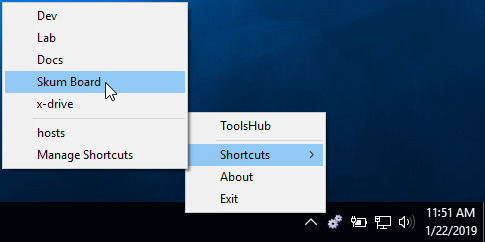

# Xeno.ToolsHub

Flexible tools launcher desktop app which is "_not your average extensible sidebar_"

**_This project is a Work in Progress_**

|||
| --- | --- |
| **License** | [](https://github.com/DamianSuess/ToolsHub/blob/master/LICENSE) |
| **Master** |  |
| **Develop** | [](https://ci.appveyor.com/project/DamianSuess/toolshub/branch/develop) |



Author: [Damian Suess](https://www.linkedin.com/in/damiansuess/)

## Active Features

* Launch app from System Tray
* Add-on extensions via [Mono.Addins](https://github.com/mono/mono-addins)

### Future Features

* Safely send shutdown signals to your add-ons
* Launch app from Sidebar (_i.e. RocketDock, ObjectDock_)
* Launch app on system startup

## Use case

### SystemTray Launcher

* **Status:** Ready
* Launch shortcuts (_apps, folders, urls_) directly from SystemTray

### Sidebar Launcher

* Launch apps, files, folders, Windows shortcuts, and web links from an icon dock.
* Drop items onto the dock to add them; drag icons to reorder them. Changes save immediately.
  While reordering, the grabbed icon follows the pointer and a blue marker shows its destination.
* Hover to enlarge an icon, click to launch, or right-click to add/remove launchers.
* In **Settings > Sidebar**, choose the monitor and Left, Right, Top, or Bottom edge.
  Layout follows the selected edge. Long lists scroll with the mouse wheel.
* Auto-hide slides the dock away after a short idle delay. Hover its thin edge strip
  to bring it back. The slide is clipped to the selected monitor, including shared edges.
  Turn **Auto-hide** off to keep the dock visible.
* A small dot beneath an icon indicates that the app has an open window. Indicators
  refresh automatically and support executable targets and Windows shortcuts.
* Sidebar appearance settings preview immediately. **Apply/OK** keeps them;
  **Cancel** restores the last saved appearance without changing launcher items.
* Enabling the Sidebar add-in shows it immediately; disabling it closes the dock.
  The startup visibility setting only controls display when the app starts.
* Enabling the Sidebar add-in shows it immediately; disabling it closes the dock.
  The startup visibility setting only controls display when the app starts.

If Explorer shows a blocked cursor when dropping onto the dock, run ToolsHub without
administrator privileges. When debugging, start Visual Studio normally too: Windows
[does not allow drag-and-drop from a non-elevated app into an elevated app](https://learn.microsoft.com/en-us/windows/win32/com/the-com-elevation-moniker).

### VeraCrypt

* **Status:** WiP
* Auto-mount drives on startup
* Safely dismount drive on system shutdown to guard against corruption

## Coding

The framework relies on [Mono.Addins](https://github.com/mono/mono-addins) for extending to add new features. We provide a list of key [extension points](https://github.com/xenoinc/ToolsHub/wiki/Addin-ExtensionPoints) you can attach to.

### Cloning

From a fresh start:<br />
``git clone --recurse-submodules https://github.com/xenoinc/ToolsHub.git``

If closed and forgot the submodule:<br />
``git submodule update --init --recursive``

### How to contribute

Read our wiki to learn how to help and make your own add-in.

### Build and test

Use the .NET 10 SDK on Windows:

```powershell
dotnet build source/ToolsHub.slnx --configuration Release
dotnet test --project source/Xeno.ToolsHub.Tests/Xeno.ToolsHub.Tests.csproj --configuration Release
```

Tests use Microsoft Testing Platform, selected by `global.json`. Pass the project with
`--project`; VSTest options such as `--logger` no longer apply.

Settings use the built-in `System.Text.Json` serializer. Existing `ToolsHub.db` files
retain their property-bag format and Base64-encoded objects; no file conversion is needed.

## Squirrel Updater

See, ``Docs\Squirrel-Usage.md`` for more info.

### Requirements

* NuGet: ``Squirrel.Windows``
* NuGet: ``NuGet.CommandLine``

### Create Installer (Official)

1. Open command prompt in root of project
2. ``MSBuild /t:MakeInstaller``
3. **Carefully copy** select output from "Releases" folder to our network share.

### MANUAL Distributing

Only perform this method if the **MSBuild** one does not.

1. **VS:** Update the version numbers in ApplicationInfo.cs
2. **VS:** Build from Release
3. **NuGet Package Explorer** (_or Notepad++_)
    1. Update .nuspec version number to match ApplicationInfo version.
    2. Click, Save As.
    3. Place file in root of project folder.
4. Execute Releasify from VS inside of project
    1. VS: View > Other Windows > **Package Manager Console**
    2. Navigate to root of project folder and **releasify**
    3. Example:
```powershell
PM> cd ..
PM> Squirrel --releasify ToolsHub.1.1.53.nupkg
```
5. Copy "Releases" output to our network share for archiving
